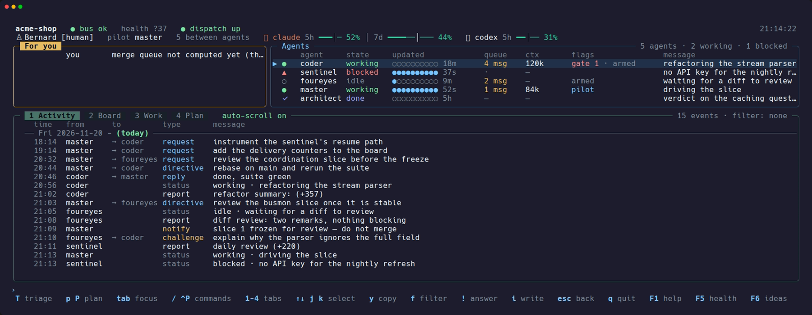

<p align="center"></p>

# agent-bus

[English](README.md) · **Français**

agent-bus fait travailler une équipe d'agents IA de programmation sur votre propre machine et la garde coordonnée :

- **Le bus.** Un bus Redis Streams : un conteneur Redis, sous un espace de noms de projet.
- **Les outils.** Deux binaires Go : `agentbus`, la ligne de commande, et `busmon`, le tableau de bord en terminal.
- **Aucune dépendance extérieure.** Il ne s'appuie sur aucun autre projet.

Il se veut **petit et léger pour vos abonnements LLM** :

- **Rien n'interroge un agent.** Un agent au repos attend sans dépenser de jetons.
- **Un réveil d'une ligne.** Un seul dispatcher tape une ligne fixe dans le terminal d'un agent quand du travail l'attend.
- **Des lectures locales.** Les fenêtres d'usage et le remplissage du contexte sont lus dans des fichiers locaux.

<p align="center"></p>

<p align="center"><sub>busmon sur un projet fictif (<code>acme-shop</code>), alimenté par <code>scripts/busmon-demo.sh</code>.</sub></p>

**Ce que vous obtenez**

- **Une équipe en une commande.** Lancez `agentbus start` dans le dossier d'un projet. Il démarre les
  rôles (master, coder, foureyes, sentinel, et d'autres à la demande) pour Claude Code, Codex et
  d'autres clients, depuis un seul manifeste, `roles.toml`.
- **Des terminaux d'agents où vous pouvez entrer.** Les agents de chaque projet tournent dans des
  terminaux hébergés par un service d'arrière-plan, le *holder* :
  - `agentbus attach <agent>` place votre terminal sur celui d'un agent ;
  - `agentbus screen <agent>` affiche son dernier écran ;
  - fermer busmon ou votre terminal n'arrête pas les agents.
- **Un tableau de bord en direct.** `busmon` montre :
  - qui travaille, qui est bloqué ou attend que vous répondiez ;
  - le tableau des tâches et les demandes suivies ;
  - les questions qui vous sont posées, et les PR qui attendent votre fusion.
- **Des réveils sans scrutation.** Le service dispatcher réveille un agent au repos quand un message
  l'attend, et escalade vers master quand personne ne répond.
- **Une livraison relue.** Chaque changement est approuvé par deux relecteurs sur son commit exact avant
  d'être poussé. Les PR vont vers la branche de livraison du projet (`dev` ici), et `main` ne reçoit que
  des promotions.
- **Une boucle de CI.** Sur GitHub, une PR dont les vérifications échouent revient à son auteur
  quelques fois, puis à vous.
- **Quotas, contexte et santé surveillés pour vous.**
  - Les fenêtres d'usage sont lues localement, et le projet se met en pause avant une limite.
  - Un agent passe la main près d'un contexte plein.
  - La santé mesurée a sa propre page dans busmon (F5).

## Où il tourne

agent-bus est en **v0.x** et conçu pour **un seul opérateur** : une personne, sur sa propre machine.
Commandes et écrans changent encore d'une version à l'autre. Il n'y a ni comptes ni contrôle d'accès,
et le broker est un Redis lié à `127.0.0.1`.

| | Linux | macOS | Windows |
|---|---|---|---|
| État | développé et utilisé tous les jours | compile, pas utilisé tous les jours | non pris en charge (ne compile pas) |
| Services (dispatcher, missions, holder) | systemd `--user` | launchd, dans votre session graphique | — |
| Broker Redis | Docker avec Compose (`redis:8-alpine`) | Docker avec Compose | — |

Sans gestionnaire de services, réglez `services.manager = none` dans `config.toml`. Les services
tournent alors comme des superviseurs détachés.

Le lanceur connaît cinq clients :

| Client | Reprise de session | État travail/repos automatique |
|---|---|---|
| Claude Code (`claude`) | oui | oui, par ses hooks |
| Codex CLI (`codex`) | pas encore | oui, par ses hooks |
| Grok Build (`grok`, bêta) | pas encore | oui, par ses hooks |
| Kimi Code CLI (`kimi`) | non | non |
| Antigravity CLI (`agy`) | non | non : l'agent le déclare |

Le remplissage du contexte et le décompte des jetons ne viennent que de Claude Code.

## Installer

Il vous faut Linux ou macOS, Go (la version de `go.mod`), Docker avec Compose, Git, curl et au moins
un client d'agent.

```bash
git clone https://github.com/netbja/agent-bus-monitor && cd agent-bus-monitor
./setup.sh install                     # binaires, compétences, broker Redis
agentbus statusline --print-install    # utilisateurs de Claude Code : le bloc statusLine de ~/.claude/settings.json
```

`./setup.sh install` fait quatre choses :

- **Les binaires.** Il compile `agentbus` et `busmon` dans le dépôt et dans `~/.local/bin`
  (`--bin-dir` change ce dossier).
- **Les compétences.** Il relie les compétences des rôles.
- **Le broker.** Il démarre le broker (`docker compose up -d`, port 6380).
- **Le mot de passe.** Sur un broker neuf, il écrit un mot de passe Redis aléatoire dans
  `~/.config/agentbus/redis.env`. `agentbus` et `busmon` le lisent là.

L'installation accepte ces options :

- `--dry-run` montre les actions et ne change rien ;
- `--no-docker` laisse le broker tranquille ;
- `--no-skills` saute les compétences.

L'étape `statusLine` donne à agent-bus les limites de débit et le remplissage du contexte de Claude
Code. Les autres clients n'ont besoin de rien.

Autres commandes de `setup.sh` :

| Commande | Ce qu'elle fait |
|---|---|
| `./setup.sh update` | `git pull --ff-only`, puis installe. Ensuite, elle liste les services de cette machine encore sur l'ancienne version et les redémarre sur votre accord |
| `./setup.sh status` | ce qui est installé |
| `./setup.sh uninstall [--yes] [--purge]` | le retire, en demandant à chaque étape ; `--purge` retire aussi le broker et ses données |
| `./setup.sh rotate-redis-password [--dry-run] [--yes]` | remplace le mot de passe du broker |

`agentbus update` installe la dernière version publiée, avec un instantané pour revenir en arrière
(`agentbus update --check` affiche le plan ; [spécification](docs/superpowers/specs/2026-11-20-agentbus-update-design.md)).
Elle refuse un build `dev` : `./setup.sh update` reste donc le chemin depuis un clone. Après une mise à jour, les agents continuent de tourner sur la version précédente
jusqu'à ce que vous les déplaciez (voir
[Mettre à jour](docs/OPERATIONAL-GUIDE.fr.md#7-mettre-à-jour-les-outils)).

## Démarrer une équipe

```bash
cd ~/code/myproject
agentbus start            # déduit le projet, le montre, le démarre, ouvre busmon
```

`agentbus start` :

1. déduit le nom du projet, le vôtre et l'équipe, et ne demande que ce qu'il ne peut pas déduire
   (`--yes` prend les valeurs déduites, `--dry-run` montre le plan) ;
2. lance `agentbus up <project> <path>`, qui démarre les services du projet et ses agents sur le
   holder du projet ;
3. ouvre busmon dans votre terminal.

Un nom de projet est en minuscules : une lettre, puis des lettres, chiffres, `-` ou `_`, 32 caractères
au plus.

**Ensuite :**

- **Rouvrir le tableau de bord :** `busmon -p myproject`. `busmon --pick` choisit parmi vos modèles de projet.
- **Redémarrer l'équipe :** `agentbus up myproject`. Ajoutez `--resume` pour reprendre les sessions des agents.
- **L'arrêter :** `agentbus down myproject` arrête les services et le holder, avec les agents qu'il
  héberge. Rien n'est supprimé.

**Joindre un agent.** Dans busmon, choisissez un agent et appuyez sur `t`. Depuis un shell :

```bash
agentbus -p myproject attach coder           # votre terminal sur celui de coder ; F12 puis d revient
agentbus -p myproject attach coder --observe # regarder seulement
agentbus -p myproject screen coder           # afficher son dernier écran, en lecture seule
```

Le préfixe d'attache est `attach.prefix`, `f12` par défaut. Un client qui ne laisse pas passer F12,
comme Kimi ou agy, demande `--prefix <key>` (`f1`-`f12`, `ctrl+<letter>`, `ctrl+\` ou `ctrl+]`).

**Qui vous êtes.** busmon écrit en votre nom : `--as <name>`, `AGENT_BUS_HUMAN`, ou `agentbus identity set
<name>`. Une commande qui écrit est refusée plutôt qu'envoyée anonymement. Dans le terminal d'un agent,
une commande écrit au nom de cet agent (`AGENT_BUS_AGENT`).

Le [guide opérationnel](docs/OPERATIONAL-GUIDE.fr.md) suit une journée avec l'équipe : lancer du
travail, le regarder, répondre aux questions, fusionner, mettre à jour et arrêter.

## Comment l'équipe travaille

- **Les rôles.** `roles.toml` les définit, et en ajouter un ne demande aucun changement de code :
  - **Les rôles de démarrage :** `master` (coordonne), `coder` (implémente, test d'abord), `foureyes`
    (relit) et `sentinel` (revue de santé quotidienne).
  - **Les rôles à la demande :** master fait apparaître `coder2`, `architect`, `docs`, `security`,
    `deploy` ou `infra` avec `agentbus pop <role>`.
  - **Les profils :** chaque rôle tourne sur un profil (client, modèle, permissions). Voir
    [les profils d'agents](docs/AGENT-PROFILES.md).
- **Le holder.** Un service utilisateur par projet et par build (`agentbus holder`). Il héberge le
  terminal de chaque agent, le garde en marche quand personne ne regarde, et c'est ce que lisent
  `attach` et `screen`.
- **Le dispatcher.** Un service (`agentbus dispatch`), et le seul écrivain automatique dans le terminal
  d'un agent. Il tape :
  - la ligne de réveil fixe ;
  - `/clear` après la passation déclarée d'un agent (`dispatch.auto_clear`).

  Il fait aussi :
  - attend tant que vous tapez dans ce terminal ;
  - escalade un agent qui ne répond pas ;
  - relance un agent mort dans un nouveau terminal (auto-réparation) ;
  - surveille quotas, contexte et santé.

  Il n'exécute jamais de code du dépôt.
- **Relecture à 4 yeux et livraison.**
  - **Relecture.** Un auteur défie deux relecteurs (`agentbus challenge`). Chacun enregistre un verdict
    sur le commit exact (`agentbus verdict --head`).
  - **Livraison.** Seul master ou l'agent docs livre : `agentbus deliver <branch>` pousse la tête
    approuvée et ouvre la PR.
  - **La base.** La PR va vers le `[delivery] base` du modèle de projet, sinon `delivery.base` (`main`
    par défaut). Ce dépôt livre vers `dev`.
  - **main.** Il ne bouge que par l'avance rapide de master vers un `dev` publié, sur votre accord.
  - **Vos fusions.** `agentbus merge-queue` liste ce qui attend votre fusion, et busmon l'affiche.
- **La boucle de CI.** GitHub avec `gh` seulement.
  - Quand les vérifications d'une PR échouent, l'auteur est réveillé avec les vérifications en échec et
    leurs liens.
  - Après `ci.max_handoffs` passations (3 par défaut), la boucle s'arrête et vous recevez un avis.
    `agentbus ci reset <pr>` donne plus d'essais à l'auteur.
  - `ci.loop = false` la désactive.
- **Les missions** pour les grands changements. Le service conducteur (`agentbus missions`) fusionne,
  teste et fait relire le travail des agents sur des branches locales, tâche par tâche
  (`agentbus mission load`).
- **Les questions qui vous sont posées.** Un agent demande avec `agentbus ask`. busmon montre les
  options, et votre réponse réveille l'agent.
- **Un budget de run** (désactivé par défaut). Avec `run.max_duration` ou `run.max_deliveries` réglé,
  l'équipe se vide à la limite et le projet se met en pause. `agentbus run reset` démarre un nouveau run.

## Commandes de tous les jours

| Commande | Ce qu'elle fait |
|---|---|
| `agentbus start` / `up <p>` / `down <p>` | démarrer une équipe (depuis son dossier) / la démarrer / arrêter ses services et agents |
| `agentbus -p <p> attach <agent>` / `screen <agent>` | entrer dans le terminal d'un agent / le lire |
| `agentbus -p <p> agents` | l'état déclaré de chaque agent |
| `agentbus -p <p> pop <role>` / `retire <role>` | ajouter un rôle à la demande / en retirer un |
| `agentbus -p <p> service status` / `service logs dispatch -n 100` | les services du projet / leurs journaux |
| `agentbus -p <p> merge-queue` | ce qui attend votre fusion |
| `agentbus -p <p> ask` / `asks` / `answer` | les questions à la personne |
| `agentbus -p <p> pause --for 2h` / `resume` | personne n'est réveillé d'ici là |
| `agentbus suspend` / `agentbus resume --all` | endormir tous les projets de cette machine avant un redémarrage / les réveiller |
| `agentbus quota` / `tokens` / `health` | fenêtres d'usage / jetons dépensés / santé mesurée |
| `agentbus backup` / `restore` | une archive des clés, réglages et historiques de chaque projet / en restaurer une |
| `agentbus config` | la valeur de chaque réglage et d'où elle vient |
| `agentbus help <command>` | l'usage, les options et les exemples d'une commande |

`--project <p>` (ou `-p`, ou `AGENT_BUS_PROJECT`) est exigé partout où une commande agit sur un projet.

## busmon

`busmon -p <project>` est votre fenêtre sur l'équipe :

- l'en-tête avec l'état des services ;
- *For you* : ce qui vous attend ;
- les agents ;
- les onglets (touches numériques) : `1` Activity, `2` Board, `3` Work, `4` Plan, la feuille de route
  du plan chargé (`p` l'ouvre en tiroir) ; sous 80 colonnes, une vue à la fois, de `1` For you à `6` Plan.

Touches utiles :

- `F1` liste toutes les touches ;
- `t` s'attache à l'agent choisi ;
- `F3` montre les services et les holders ;
- `F5` montre la santé ;
- `M` montre tous les projets de cette machine ;
- `C` ouvre les réglages ;
- `q` quitte.

Réglages d'affichage, modifiés depuis `C` ou dans `config.toml` :

| Réglage | Valeurs (la première est la valeur par défaut) |
|---|---|
| `display.theme` | `auto`, `dark`, `light` |
| `display.graphs` | `auto`, `block`, `braille`, `ascii` |
| `display.icons` | `off`, `nerd`, `agent-font` |
| `display.date_format` | `relative`, `iso`, `clock12` |
| `display.work_layout` | `auto`, `list`, `kanban` |

`agentbus config` liste chaque réglage, sa valeur et sa source.

## Réglages

Vos préférences vivent dans un seul fichier, `~/.config/agentbus/config.toml`, sous
`$XDG_CONFIG_HOME` quand il est défini :

- **Priorité.** L'environnement l'emporte sur le fichier, et le fichier sur les valeurs par défaut.
- **Les voir.** `agentbus config` montre chaque valeur et d'où elle vient ; `--project <p>` ajoute ce
  que voient les services de ce projet.
- **Les secrets restent hors de ce fichier.** Les cibles de notification sont dans `notify.toml` à côté,
  et le mot de passe Redis est dans `redis.env`.

Réglages qu'un opérateur touche d'ordinaire :

- **Livraison :** `delivery.base`, `delivery.forge`.
- **Boucle de CI :** `ci.loop`, `ci.max_handoffs`.
- **Budget de run :** `run.max_duration`, `run.max_deliveries`.
- **Services et terminaux :** `services.manager`, `services.start_at_login`, `attach.prefix`.
- **Contexte :** `dispatch.context_alert` (80 %), `dispatch.auto_clear`.
- **Notifications :** `notify.on`.
- **Sauvegardes :** `backup.schedule`.

## Le broker et les connexions

- **Le broker.** `docker compose up -d` démarre `redis:8-alpine`, lié à `127.0.0.1:6380` seulement,
  jamais au réseau local. Le mot de passe circule en clair : le broker n'est donc jamais exposé tel quel.
- **Ordre de connexion.** `agentbus` et `busmon` se connectent avec `REDIS_URL` quand elle est définie.
  Sinon ils utilisent `REDIS_HOST` / `REDIS_PORT` (`localhost` / `6380`), avec le mot de passe de
  `REDIS_PASSWORD`, sinon de `~/.config/agentbus/redis.env`. `--host` l'emporte sur `REDIS_HOST`.
- **Regarder le bus d'une autre machine.** Utilisez un tunnel SSH :

```bash
ssh -NL 6381:localhost:6380 user@your-host &   # le bus de cet hôte sur :6381 en local
REDIS_PORT=6381 busmon -p <project>              # avec le redis.env de cet hôte ou REDIS_PASSWORD
./remote-bus.sh user@your-host                   # pareil, le tunnel fermé à la sortie
```

Les terminaux des agents sont locaux à la machine dont le holder les héberge : vous vous y attachez
là-bas, pas à travers le tunnel.

## Pas encore construit

Ceci est écrit en spécifications et n'est pas construit :

- La mise à jour discrète, le mode automatique de `agentbus update`
  ([spécification](docs/superpowers/specs/2026-11-14-quiet-update-design.md)) : `agentbus update` est manuelle.
- `agentbus feedback`, des statistiques sur les relectures passées
  ([spécification](docs/superpowers/specs/2026-10-29-feedback-loop-design.md)).
- Des lecteurs de PR pour GitLab et Bitbucket. D'ici là, la file de fusion et la boucle de CI ne lisent
  que GitHub, alors que `agentbus deliver` ouvre déjà des merge requests GitLab et affiche la page de
  Bitbucket.

## Pour aller plus loin

- [Guide opérationnel](docs/OPERATIONAL-GUIDE.fr.md) : faire tourner une équipe au quotidien.
- [Architecture](docs/architecture.md) (en anglais) : les paquets, les flux et les clés, qui écrit quoi.
- [Notes d'exploitation](docs/operator-notes.md) (en anglais), avec les plus récentes dans
  [docs/operator-notes.d/](docs/operator-notes.d/) : les détails qui piègent.
- [CHANGELOG](CHANGELOG.md) et [notes de version](docs/releases/) (en anglais).
- Développer agent-bus lui-même : voir [CLAUDE.md](CLAUDE.md) et [AGENTS.md](AGENTS.md). Les tests
  n'utilisent qu'un Redis jetable ([installation de Redis pour les tests](docs/testing-redis.md)).

## Licence

MIT, voir [LICENSE](LICENSE). Copyright (c) 2026 NetBJA.
