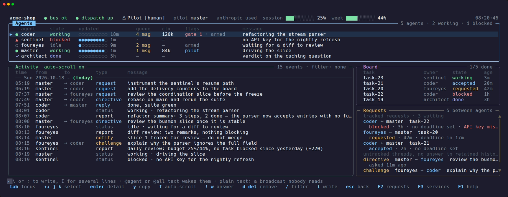

<p align="center"></p>

# agent-bus

A self-contained multi-agent coordination bus over **Redis Streams**, plus the Go tooling
around it. Agents publish status, commands and notifications on a shared Redis instance, under
a required project namespace. `busmon`, a terminal dashboard, shows the traffic live. The
broker, the client and the monitor all live here; nothing depends on any other project.

<p align="center"></p>

<p align="center"><sub>busmon on a fictional project (<code>acme-shop</code>), seeded by <code>scripts/busmon-demo.sh</code>.</sub></p>

**What you get**

- **A shared bus** — status, reports, directives and notifications per project, with
  at-least-once delivery to each agent (`agentbus subscribe`).
- **A live dashboard** — who is working, blocked or waiting for a person; the board of tracked
  tasks; the requests nobody answered yet (`busmon`).
- **Wake-ups without polling** — a dispatcher nudges an idle agent's terminal pane when work
  is waiting for it, and escalates when nobody answers (`agentbus dispatch`).
- **A team in one command** — master, coder, reviewer and sentinel roles, launched for Claude
  Code, Codex and others from one manifest (`agentbus up`, `roles.toml`).
- **Large changes as missions** — a conductor merges, tests and reviews agents' work
  (`agentbus missions`).

## Quick start

```bash
git clone https://github.com/netbja/agent-bus-monitor && cd agent-bus-monitor
./setup.sh install --install-herdr     # toolchain check, binaries, skills, herdr-plus, Redis
herdr --session myproject              # then, inside herdr:
agentbus up myproject ~/code/myproject --as <your-name>
```

`agentbus up` provisions the team and opens its workspace, with busmon first. Later,
`Ctrl+B` then `↑` reopens any project.

- `./setup.sh update` keeps the machine current; busmon shows `↑ vX.Y.Z` in its header when a
  newer release exists.
- `./setup.sh status` shows what is installed.
- `./setup.sh uninstall` removes it, asking first at each step.

**What's new:** see the [CHANGELOG](CHANGELOG.md), and [`docs/releases/`](docs/releases/) for
the full notes of each version. The step-by-step guides are in English and French:
[Operational guide](docs/OPERATIONAL-GUIDE.md) · [Guide opérationnel](docs/OPERATIONAL-GUIDE.fr.md).
Once the team is up, section 6 of the guide shows how to start a small task and a multi-day
change ([EN](docs/OPERATIONAL-GUIDE.md#6-starting-work-a-small-task-a-large-change) ·
[FR](docs/OPERATIONAL-GUIDE.fr.md#6-démarrer-le-travail--une-petite-tâche-un-grand-changement)).

## Components

| Piece      | What it is                                                                  |
|------------|-----------------------------------------------------------------------------|
| broker     | `redis:8-alpine` on `localhost:6380` (`docker-compose.yml`)                |
| `bus/`     | Go package: connection, Streams API (`Bus` handle), publish helpers         |
| `agentbus` | CLI client — status/report/notify/cmd/subscribe/listen (`cmd/agentbus`)     |
| `busmon`   | TUI dashboard: Agents / Activity / Board / Requests (`cmd/busmon`)          |
| `dispatch/`| Wake dispatcher behind `agentbus dispatch`: wakes unarmed agents via herdr  |

## Deployment topology (current: machine ⇄ remote machine)

The bus is consumed by a concrete two-host setup. This is how the pieces wire up
today — and, importantly, where they *don't* connect.

- **Broker** runs on the **laptop/desktop** (`docker compose up`, redis:8-alpine on `:6380`).
- The **remotebox** (`user@remotebox`) reaches it through an SSH tunnel it opens *to* the laptop/desktop:
  `ssh -L 6380:localhost:6380 user@laptop -N`. So `agentbus --host 127.0.0.1`
  on the remote box publishes onto the laptop's bus.
- Two Claude Code sessions run on the laptop under **herdr** in `~/myproject`
  (agents `claude1`, `claude2`); a **hermes agent** runs on the remote box.

**Inbound to the laptop Claudes — `agentbus subscribe` (the canonical bridge).**
A session arms `agentbus subscribe <agent> [idle_secs]` as a Claude Code background task. It blocks
on the project's `:cmd` stream via XREADGROUP, emits one JSON object per fire (a `cmd` object, or a
`heartbeat` object after the idle window, default 240s) then exits — and that exit re-invokes the
Claude session that armed it. Each session re-arms after every fire. The whole loop lives in the `agentbus` binary, so
there is **no wrapper script and no watcher daemon** in the agent path. `busmon` runs alongside as
the human dashboard.

> This supersedes `myproject/tools/bus_watch.sh` (a thin shell wrapper over `agentbus watch`)
> and the persistent `~/.hermes/scripts/bus_watch_hdl.sh` logger loop. An even earlier prototype,
> `cmd/busbridge`, relayed `hermes:cmd:*` into herdr panes with hard-coded pane IDs. Don't
> reintroduce a wrapper script — a restart loop never wakes a terminal session. v0.8 revised the
> pane-relay part on purpose ([decision](docs/memory/decisions/2026-10-10-event-driven-dispatch.md)):
> **the only automated process that types into panes is `agentbus dispatch`, and it types a wake
> line, never a message; master's manual pane injection remains the fallback while no dispatcher
> runs.** Pane ids are self-registered (or bound with `agentbus bind`) and pid-verified, not hard-coded.

**Separate notification path — NOT the bus.** The `Stop` hook in
`myproject/.claude/settings.local.json` calls `hermes-notify`, which HMAC-signs a POST to
the remote box's hermes **gateway** at `http://<remote>:8644/webhooks/claude-notify`. That route is
`Deliver: signal`: it pings a human over Signal when a Claude task stops. The gateway never
touches Redis, so this path is **independent of the agent bus** — webhook traffic does not appear
on `hermes:*`, and the bus carries nothing back to Signal.

## Run the broker

```bash
docker compose up -d        # redis:8-alpine on :6380, compose project "agent-bus"
docker compose ps
```

Password defaults to `AgentBus2025!`; override via `REDIS_PASSWORD` (see
`.env.example` → copy to `.env`). Redis Streams entries are capped at ~1000 per
stream (XADD MAXLEN ~); the pilot lease and challenge gates use ordinary keys/hashes.

> The broker is bound to **loopback only** (`127.0.0.1:6380:6379` in `docker-compose.yml`), so it
> is not reachable from the LAN — the SSH tunnel below is the only remote path. This matters
> because the Redis password travels in plaintext. (It previously mapped `6380:6379`, i.e. bound
> `0.0.0.0`; verify the active bind with `ss -tlnp | grep 6380`.)

## Install the tools

### `setup.sh` (recommended)

Run it from a clone. It is idempotent, so re-running it is safe:

```bash
./setup.sh install                 # check the toolchain (Go from go.mod), build agentbus + busmon,
                                   # clone the external skills, link role skills, start Redis
./setup.sh install --install-herdr # also install herdr (if missing) and the herdr-plus plugin
./setup.sh install --dry-run       # list what is missing and what would change; changes nothing
./setup.sh update                  # git pull --ff-only, then install; prints vA -> vB
./setup.sh status                  # versions, PATH shadowing, skills, herdr-plus, Redis
./setup.sh uninstall               # asks at every step (--yes: cautious defaults, --purge: Redis data too)
```

What `install` does:
- **Binaries.** Both binaries are rebuilt on every run, into the repository (where the herdr tabs
  run them) and into `--bin-dir` (default `~/.local/bin`). They carry the release they were built
  from (`agentbus version`, `busmon --version`).
- **herdr-plus.** It is registered with herdr's own plugin store:
  `herdr plugin install cloudmanic/herdr-plus --ref <tag>`, or `herdr plugin link` for a local
  checkout set with `HERDR_PLUS_PATH`. `install` then checks that its Projects action exists.
  A new pin in a later release reinstalls the herdr-plus that setup installed; a linked checkout
  is never replaced.
- **The `Ctrl+B` `↑` binding.** It is added to herdr's `config.toml`, which is created if herdr
  has never run. A running herdr reloads it at once (`herdr server reload-config`).
- **External role skills** (`mattpocock/skills`, pinned tag): cloned into
  `${XDG_DATA_HOME:-~/.local/share}/agentbus/skills/mattpocock`. A skill that is still missing
  only warns, in `agentbus up` and when an agent starts; the agent runs without it. A folder
  there that setup did not clone is left alone.

`update` refuses a tree with uncommitted changes, fast-forwards it, then runs the `setup.sh` it
just pulled.

`uninstall` asks before each removal, and removes only what setup made:
- every project's services (their units; data and logs are kept);
- our binaries and our skill links (never a real directory);
- the herdr key binding, if it is still exactly the block setup wrote (an edited one is kept);
- the external skills, if setup cloned them and they have no local changes;
- Redis: stop it (keep the data), remove it with its data, or leave it.

herdr-plus is asked separately, because it is useful without agent-bus. The repository itself is
left in place. It has no `--dry-run`: run it without `--yes` and answer each question.

### Manual build

```bash
go build -o busmon ./cmd/busmon
go build -o agentbus ./cmd/agentbus
go install ./...            # -> $GOBIN/busmon, $GOBIN/agentbus (version "dev": no update notice)
```

## Use it

`AGENT_BUS_PROJECT` (or `--project <p>`) is required for all commands except `agentbus mem`
([shared memory](#shared-memory-agentbus-mem), which works on files only) and `agentbus roles`
(the role manifest the scripts use: `validate`, `tier`, `field`, `launch`, `install`, `template`;
no Python any more).

> **Agents:** a copy-paste command reference (with the flag/positional traps that
> cause retries) lives in [`docs/AGENT-BUS-GUIDE.md`](docs/AGENT-BUS-GUIDE.md).
>
> **Operators / Getting Started:** A step-by-step operational guide for setup, herdr,
> herdr-plus and workflows is available in [English](docs/OPERATIONAL-GUIDE.md) and
> [French](docs/OPERATIONAL-GUIDE.fr.md).

```bash
# Set project once in the shell (or pass --project on each call):
export AGENT_BUS_PROJECT=myproject

agentbus status claude1 working "plan 10 shipped"  # trailing words are joined
agentbus notify "soak 24h started"
agentbus cmd [--ref T] claude2 run the suite       # directive; prints the entry id (thread root)
agentbus thread 1782588072942-0                    # show the :cmd thread (ref or id == arg), chronological
agentbus report claude1 "bug fixed"                # curated report (note kind)
agentbus report claude1 --auto "soak 24h done"     # auto = Stop-hook safety net
agentbus reports                                   # list recent reports ((+N) = full text retained)
agentbus reports --json                            # same list, machine-readable JSON
agentbus reports <id>                              # print one report's full retained text
agentbus subscribe claude1                         # block for next cmd then exit (re-arm to stay subscribed)
agentbus subscribe claude1 3600                    # same, with a 1h idle window before the heartbeat object
agentbus subscribe --drain claude1                 # woken by a dispatcher line? drain first: JSONL per waiting entry, exit 0/64 empty/75 error
agentbus cmd --no-wake claude2 for later           # wake=no: delivered at its next drain/subscribe, never wakes it
agentbus dispatch                                  # wake dispatcher (foreground; one per project; JSON log on stderr)
agentbus dispatch --status                         # "dispatch up" (exit 0) or "dispatch down" (exit 1)
agentbus listen                                    # debug tail (all four streams)
agentbus pilot claim --ttl 120s                    # claim pilot lease (self = AGENT_BUS_AGENT)
agentbus gate claude2                              # list open 4-eyes challenges; exit 1 if gated
agentbus verdict --pr 25 myagent approve "LGTM"    # write verdict to {p}:verdicts; --ref resolves matching gate (best-effort)
agentbus verdicts --pr 25                          # roll-up 4-eyes state: APPROVED/REJECTED/PENDING (exit 0/3/2); no-arg lists recent
agentbus usage                                     # print every agent's budget; usage <a> '<json>' writes one
agentbus version                                   # print the bus protocol version (no project/broker needed)

busmon --list                                      # what projects are on this bus? (no --project needed)
busmon --project myproject                         # live dashboard (last 25 lines, then live)
busmon --project myproject --limit 100             # backfill the last 100 lines on launch
busmon --project myproject --limit 0               # replay all retained history (pre-limit behavior)
busmon --project myproject --reset                 # purge the project's streams first (asks to confirm)
busmon --project myproject --reset --yes           # purge without the confirmation prompt
busmon --delete oldproject                         # retire a project: DEL every one of its keys (asks to confirm)
busmon --delete oldproject --yes                   # ...without the confirmation prompt
```

The `subscribe` output carries `"v"` (= `bus.ProtocolVersion`, currently 1). Changes within a
version are additive only (consumers must ignore unknown fields); `v` bumps only on a breaking subscribe-contract change (a field
removed/renamed/repurposed or a semantics change). A consumer that sees an unknown higher `v` should
fail loud, not best-effort. Stream entries and `agents`/`usage`/`verdicts` output are not versioned.
`subscribe --drain` events reuse the same object (one per line, no `rearm`) and may add `stale`
(entry older than the 24h horizon) and `age_s`; never act on a stale entry without confirmation
from its sender or master. A woken agent must drain rather than run a plain `subscribe`, which
floors at "now" and acknowledges the waiting entries unseen. The cmd `type` field can also be
`escalation` (from the dispatcher to `--escalate-to`, default `master`) or `blocked` (from
`request block`, to the requester, once per new reason).

On launch, busmon backfills only the **last `--limit` ACTIVITY lines** (default `25`, merged across
all four streams) before live-tailing — set a persistent default with `AGENT_BUS_BUSMON_LIMIT`, or
`--limit 0` to replay everything. `--reset` clears the project's history (`XTRIM` of the four
streams — it keeps consumer groups and the armed/pilot/gate leases, so cmd delivery is unaffected)
after a `[y/N]` confirmation; a piped/non-TTY stdin counts as "no".

`busmon --list` is the way back in when you have forgotten a project's name — it is the only busmon
invocation that does **not** need `--project`, since that is the question it answers:

```
$ busmon --list
PROJECT             AGENTS  MASTER  LAST ACTIVITY
project-a         6  master  2m ago
agent-bus-monitor        2  -       3h ago
demo                     0  -       23d ago
```

Newest activity first, so the project you just left is the top row. It prints to stdout and exits
(nothing else does — pipe it), reports an empty broker on stderr, and never writes: combined with
`--reset` the list still wins and nothing is purged. `AGENTS` counts every agent the project has
ever seen — the `{p}:agents` hash is never pruned — so a retired peer still counts; `LAST ACTIVITY`
is what carries recency. A project purged with `--reset` keeps its date (the hash outlives the
`XTRIM`); `never` means nothing on it was ever dated.

`busmon --delete <project>` is the other half: it retires a project by `DEL`-ing every `{p}:*` key.

```
$ busmon --delete demo-2574
Delete ALL 2 keys for project 'demo-2574' (0 agents, last activity 23d ago)?
This is a DEL, not --reset: streams, consumer groups, agents/usage/budget/verdicts, pilot and gate leases all go. [y/N] y
Deleted 2 keys for project 'demo-2574'.
```

**`--reset` and `--delete` are deliberate opposites.** `--reset` clears the history of a project you
are keeping — an `XTRIM`, so consumer groups and the armed/pilot/gate leases survive and cmd
delivery is unaffected. `--delete` removes a project you are not keeping, and takes all of that with
it. Same `[y/N]` gate and same `--yes` bypass as `--reset`; the prompt states the key count, agent
count and last activity, because a slug alone is a poor thing to judge on. A project with no keys is
a no-op success, so a repeated cleanup script does not fail on its second run.

### Shared memory: agentbus mem

What the team decided and learned lives in [`docs/memory/`](docs/memory/INDEX.md), reviewed
through Git like the code. `agentbus mem` keeps it usable — it reads and writes files in the
working tree only (no project, no broker, never commits):

```bash
agentbus mem check                     # structure, links, metadata, index copy; WARN on stale notes
agentbus mem check --strict            # stale notes fail too (--stale-after 60d by default)
AGENT_BUS_AGENT=coder agentbus mem new lesson pel-floor --title "PEL floor"   # dated note + index line
agentbus mem sync                      # refresh the index copy in AGENTS.md after editing INDEX.md
```

A new note is a stub: `mem check` fails until its `<!-- mem:fill -->` sections are written and
it links a piece of evidence. AGENTS.md carries a generated copy of the index so that clients
which load only AGENTS.md see it at boot; Claude Code imports the real file from CLAUDE.md. See
[the memory protocol](docs/memory/PROTOCOL.md).

### Missions: agentbus missions (v0.10)

For a large change worked on by several agents over several days, the plan stays in Git and the bus
runs it. A change's tasks become **missions** in `docs/changes/<change>/missions.json` (agent,
reviewer, dependencies, allowed paths, test command, brief). A deterministic **conductor** — no LLM
— requests each mission once its dependencies are integrated, rejects a delivery that touches files
outside its allowed paths or whose tests are red, opens a 4-eyes review on the assigned reviewer,
and merges approved commits into `change/<change>` (never `main`, never a push). Master only
arbitrates what is blocked.

```bash
agentbus missions                                   # the conductor (one per project, a herdr tab)
agentbus mission load docs/changes/chg/missions.json@HEAD
agentbus mission status [chg]                       # where each mission stands
agentbus mission retry chg/t3                       # a blocked mission gets a new attempt
agentbus mission reassign chg/t3 codex              # …or goes to another agent
agentbus mission skip chg/t3 --reason "done by hand" # …or is marked done so its dependents proceed
agentbus mission load docs/changes/chg/missions.json@HEAD --force "reworded t3"  # a revised plan (rev n+1)
agentbus mission load --recover docs/changes/chg/missions.json@HEAD           # rebuild after losing Redis
agentbus mission abort chg --reason "wrong plan"
# agents deliver with:
agentbus request done <task> --commit <sha> --branch <b> "<summary>"
```

For a short, Claude-only change, Claude Code's agent teams are lighter; missions are for mixed
teams (Codex, Kimi, Grok, agy…) and work that must survive restarts. Limits (spec §6.7): the
conductor and the agents share one machine and repository, and running a mission's tests runs the
agent's committed code as your user — load only plans you have reviewed, and keep secrets out of
the conductor's environment. A mission accepted but not delivered within its `timeout` (4h by
default) is blocked and escalated. busmon shows `missions up/down`; the bootstrap template opens a
`missions` tab (`--no-missions` to omit it). Spec: `specs/2026-10-11-missions-design.md` (design spec, kept out of the repository).

## busmon panes

A btop-style dashboard (v0.9); the [screenshot at the top](#new-in-v090--busmon-redesign) shows it at
160 columns on a demo project.

<details><summary>The same layout as text, 120 columns</summary>

```
 uidemo   ● bus ok   ○ dispatch down   autonomous   1 request waiting · oldest 1h                       19:30:14
╭─ Agents ──────────────────────────────────────────────────────────── 4 agents · 2 working · 1 blocked ─╮
│    agent     state     updated             queue    ctx     flags               message                │
│▶ ▲ grok      blocked   ████░░░░░░ 6m       ·        —       gate 1              needs review of PR #46 │
│  ○ codex     idle      ███████░░░ 3m       1 msg    64k     deferred            waiting                │
│  ● kimi      working   █████████░ 40s      ·        —       armed               running tests          │
│  ● master    working   ██████████ 12s      ·        182k    pilot · armed       coordinating v0.9      │
╰────────────────────────────────────────────────────────────────────────────────────────────────────────╯
╭─ Activity  live ──────────────────────── 8 events · filter: none ─╮╭─ Board ─────────────── 0/1 done ─╮
│  time   from      to         type       message                   ││  task      owner     state    age │
│  ── Sat 2026-10-10 ───────────────────────────────────────────────││  ui-theme  codex     working  1h  │
│  18:23  master    → codex    directive  review render.go          │╰──────────────────────────────────╯
│  18:23  kimi                 report     go test ./... passed      │╭─ Requests ─────────── 1 waiting ─╮
╰───────────────────────────────────────────────────────────────────╯╰──────────────────────────────────╯
› i or : to write · @agent or @all text wakes them · plain text: a broadcast nobody reads
 tab focus   ↑↓ j k select   enter detail   y copy   / filter   i write   esc back   F2 requests   F1 help   q quit
```

</details>

- **Header** — the project, then the **monitor's own** link to Redis (`● bus ok`, or
  `▲ bus down 42s` — a broker busmon cannot reach looks exactly like a quiet team, and the
  two call for opposite reactions), the dispatcher (`● dispatch up` / `○ dispatch down`),
  the pilot (`pilot <name>` or `autonomous`), what is waiting on someone, the account budget
  **used** per provider (session and week gauges) and the clock. Health and dispatch are never
  truncated; the rest gives way from the right on a narrow terminal.
- **Agents** — one row per agent, **attention first**: escalated, gated or blocked; then
  queued or being woken; then working, idle, done, and agents that never declared a state.
  Columns: the **declared** state (never overwritten by silence — an agent that said
  `working` three hours ago still reads `working`), how old that declaration is (the bar
  empties over 10 minutes: freshness, not liveness — the bus has no heartbeat), the
  wake-eligible **queue** (`·` measured zero, `—` not measured yet, `2?` last read failed),
  its own context in raw **tokens** (never a percentage), and up to two flags in words:
  `escalated`, `gate N`, `deferred`, `unobserved`, `waking`, `woken` (the dispatcher saw its
  nonce echoed — not proof anything was read), `pilot`, `armed` (a lease, not a state),
  `stale N`. The panel holds about a third of the screen and scrolls (scrollbar on its right
  border); **Enter** or a click opens the agent's detail: full status message, pane and pid,
  lease, queue with the shared-stream lag and its caveat, wake record, possible gap ("possible,
  not proven"), gates, context, board tasks and its last activity lines.
- **Activity** — one line per event in columns `time · from · to · type · message`, a day
  separator at each date change. It follows the feed live; moving up (or the wheel) pauses it
  and the title counts `paused · N new`; **End**/**G** or **Esc** returns to live. **/** filters
  (`@agent`, a thread id, words); the filter stays shown in the title. **Enter** opens the
  message, **y** copies the line (OSC52, works over SSH).
- **Board** — the shared task board: `task · owner · state · age`, newest first; Enter opens
  the task (with its branch).
- **Requests** — tracked requests still waiting, then cmd threads with no answer in the
  retained history (never shown as accepted); the header counts both.
- **Input** — `i` or `:` to write, `@` to start a directive; `@<agent> <text>` sends a
  directed cmd (Tab completes the name) that wakes the agent, `@all <text>` one to every agent.
  Plain text is a notify that no agent reads and nothing wakes for: the first Enter says so, a
  second one sends it. Esc leaves it and keeps the draft. For more than one line, **`I`** opens
  the **compose window** (v0.16): Enter is a new line, **Ctrl+S** sends, **Tab** moves to the
  recipient (`@agent`, `@all`, empty for a broadcast), **Esc** closes and keeps the draft;
  **Ctrl+O** or **Alt+Enter** in the line (its end says so), or a paste with several lines, moves the text there. `I` in an agent's
  detail writes to that agent. The free answer in the question panel uses the same window. You write as a **person**: `busmon
  --as bernard` (or `AGENT_BUS_HUMAN`) shows "♙ Bernard [human · pilot]" in the header (`pilot`
  while you hold the lease); with no name it is "♙ Pilot [human]". Your entries carry `human=yes`,
  and agents see `"human": true`.

**Responsive.** At 120 columns and more, the layout above. From 80 to 119, the header takes
two lines and the lower area becomes tabs (`1 Activity · 2 Board · 3 Requests`). Under 80,
one view at a time (`1 Agents · 2 Activity · 3 Board · 4 Req`), with health and dispatch
still in the header; under 30×6, busmon only says the terminal is too small. It runs the same
inside herdr or in any terminal.

**Theme.** busmon draws on the terminal's own background. `--theme auto|dark|light` (or
`AGENT_BUS_BUSMON_THEME`; `auto` reads `COLORFGBG`, else dark) picks the accent palette; a
16-colour terminal gets a 16-colour palette, and `NO_COLOR` turns colour off entirely (bold
and reverse only). Every state is also a glyph and a word, so colour is never the only signal.
Frames are drawn with single-cell glyphs only and every width is measured in cells; the
box-drawing characters assume the terminal renders East-Asian "ambiguous" width as narrow
(the default in Western locales).

### Overlays: summary on screen, detail on demand

Details sit over the layout, one keypress away, so the panes stay compact. A detail is modal:
keys and clicks outside it go nowhere; Esc or `q` closes it and puts focus back where it was.

**Enter — the message in full.** The feed shows one clipped line; this shows the
whole entry: author, addressee, absolute date and age, entry id, thread, and the
body with its newlines intact. `y` copies the text exactly as published, `Y` the
whole thread. For a `cmd` it also lists the thread transcript — the directive, its
replies and its verdict, in order — so an exchange interrupted halfway can be read
back without hopping between terminals.

It also states **how much of the text is really there**, which the feed cannot:

| line | meaning |
|---|---|
| `complete — this is the whole message as published` | the entry carries `text_complete: yes` |
| `truncated at publish — the rest was never stored` | `text_complete: no` — the entry is *marked* as cut; re-reading will not bring it back, the author has to resend |
| `one-line preview, no further text retained` | no `full` field was stored |
| `completeness not marked on this entry` | published before the marker existed, so completeness is **unknown** |
| `not retained — this id reads back empty (cause unknown)` | an empty read cannot tell a trimmed entry from a deleted one, or from an id that never existed |

A trailing `…` is deliberately **not** read as proof of truncation: the sanitiser
writes one when it cuts, but so do authors.

**r / F2 — what is waiting on someone.** Tracked requests from the board, ordered
by what needs attention (blocked, then unclaimed, then in progress, then done),
each with its target, age, what would move it, and the evidence: the deadline
**only when `expires_at` is set**, and the delivery disposition in words.
`output_written` renders as *written to subscriber output (not proof it was read)* —
never as received or accepted; `queued` means no output was **recorded**, not that
none was ever written; a body that reads back empty is reported as *not retained,
cause unknown* and never implies the work is done. Cmd threads
with no answer in the retained history are listed separately and labelled as
carrying no acceptance signal at all, because the protocol records none for them.

**? / F1 — the legend.** Keys (generated from the same table that drives the footer),
states, flags, activity types and the delivery vocabulary, in words.

### Liveness model (why no dedicated heartbeat)

Agents are one-shot CLI invocations, not daemons — nothing is alive between
invocations to emit a periodic heartbeat. Liveness is derived **passively** from
the Redis stream-entry timestamp of each agent's last `status` or `report` entry:
every such publish *is* the heartbeat. A dedicated heartbeat stream would buy nothing
the existing traffic doesn't, until agents become long-running.

What busmon will **not** do with that signal is guess. Silence is reported as
silence (the age of the declaration), never as `offline`; a report moves liveness but not the
declared state; an armed lease is shown as a lease; and no agent's presence is ever
used to infer that its task has progressed. Task state comes from the board, and
acceptance only from an explicit request transition.

### Reproducing the screens

`scripts/busmon-demo.sh` builds an isolated bus for demos and renders — its own
Redis container on port 6390, its own throwaway `acme-shop` project (a fictional web shop), never the real
broker on 6380:

```bash
scripts/busmon-demo.sh up                          # start + seed the demo bus
scripts/busmon-demo.sh run                         # busmon against it
scripts/busmon-demo.sh capture out.txt ./busmon F2 # one screen, via tmux, to a file
scripts/busmon-demo.sh down                        # remove the container
```

The README screenshot is rendered from that bus by [vhs](https://github.com/charmbracelet/vhs)
(needs `ttyd` and `ffmpeg`): `scripts/busmon-demo.sh up && vhs scripts/busmon-demo.tape`.

The seeded data is deliberately awkward — an agent that declared `working` and went
quiet, an agent known only to the agents hash, a long multi-line Unicode report, a
pre-retention report, an answered thread, an unanswered directive, and a tracked
request in each state. `docs/captures/` holds the before/after renders produced this
way.

## Bootstrap a team

`scripts/bootstrap` brings a whole team up from one keypress, and the master can **pop** extras on
demand — both go through one shared launch recipe. It's shell tooling *around* the bus
(`scripts/`, `roles/`, `roles.toml`), not part of the bus protocol.

### One-time setup

`./setup.sh install --install-herdr` (above) does all of it:
- the binaries;
- the role skills, including the external collection;
- herdr-plus, registered with herdr;
- the `Ctrl+B` `↑` binding for its Projects picker;
- the broker.

If you use `--cron`, make sure `agentbus` is on the cron job's `PATH`; the trigger prepends
`~/.local/bin`.

### Start a new project — one command

```bash
herdr --session myproject                                   # start herdr (a session per project is handy)
agentbus up myproject /path/to/your/project --as <your-name>   # inside it
```

`agentbus up`:
- **Provisions** the project, which is `scripts/bootstrap` underneath: broker up, skills linked,
  template written to `~/.config/agentbus/projects/<p>.toml` (`AGENTBUS_PROJECTS_DIR`). It accepts bootstrap's flags (`--no-dispatch`, `--no-missions`,
  `--index`, `--cron`, `--session`).
- **Starts the project's services**: `dispatch` (wakes idle agents) and `missions` (the
  conductor). They run under your system's own service manager (systemd `--user` on Linux,
  launchd on macOS), not in a tab. Closing busmon, the workspace or herdr no longer stops them.
  When no manager is usable, `up` says so and opens them as tabs; `--tabs` forces that.
- **Opens the workspace** directly, with busmon first and focused, then one tab per boot role.
- **On a re-run**, it focuses the open workspace instead of opening a second one.
- **Outside herdr**, it only provisions, and tells you how to open the workspace.

The Projects picker (`Ctrl+B` then `↑`) reopens any provisioned project later. The bare
`scripts/bootstrap new myproject /path` still works, if you prefer to open the workspace from
the picker.

`bootstrap` alone **launches nothing** — it provisions (broker up, skills linked, **herdr-plus checked in
herdr**, template written); `agentbus up` does that and then opens the workspace. The 2nd argument is where the team works — every
agent's cwd, and where `--index` builds the index; omit it to use `$PWD`. It is **not** the tooling
repo (broker, `agent-launch`, `busmon` stay here). The linked session is `$HERDR_SESSION` (so
running from inside it just works), else the project name — pass `--session <name>` if your herdr
session is named differently. The workspace opens with a `busmon` tab first, then one tab per boot role —
`master`, `coder`, `foureyes`, `sentinel`. Each tab launches its configured client and role.
Agents publish presence on the bus and recover tracked work; with dispatch up, an idle unarmed
agent is woken through its pane when work lands for it, whatever its client's background-task
support (only clients with a probed screen signature are prompted).

### Project services: start, watch, stop

| Command | What it does |
|---|---|
| `agentbus up <p>` | installs or updates the services, starts what is not running, then opens the workspace; `--no-dispatch` / `--no-missions` skip one |
| `agentbus down <p>` | stops the project's services and deletes nothing; the agents and the workspace stay open |
| `agentbus --project <p> service status` | the manager's view and the last state each service published |
| `agentbus --project <p> service logs [dispatch\|missions] [-n 50]` | the service's own log (`~/.local/state/agentbus/<p>/<kind>.log`, rotated at 1 MiB × 3) |
| `agentbus --project <p> service restart\|stop\|start\|remove [kind]` | one service; `remove` keeps data and logs |
| `agentbus service list` | every project's services on this machine |

- **Nothing starts at login.** A reboot starts no project; `agentbus up` does.
- **Bounded restarts.** A service that fails is restarted; after 5 failures in 10 minutes it
  gives up and says so. It is not restarted at all when it is stopped on purpose, when its
  project was deleted, when another instance holds the lease, or when its configuration is
  invalid. The next `agentbus up` tries again.
- **busmon shows it.** The header reads `dispatch ready`, `dispatch waiting herdr`,
  `missions idle`, `missions busy`, `missions failed` and so on. `F3` (or `s`) opens the Services
  overlay, with the last error and the tail of the log.
- **Stopping during an integration** (`down`, or a stop) kills the running tests with their
  process group. The conductor redoes that check or integration at its next start.
- **Secrets.** The broker password is kept in `~/.config/agentbus/services/<p>.env` (0600),
  never in a unit, an argument or a log.
- **Removal.** `busmon --delete <p>` removes the project's services on this machine before its
  keys. `./setup.sh uninstall` removes every project's services first.
- **Upgrade.** A running service keeps the binary it started with. `./setup.sh install` lists
  them; `agentbus --project <p> service restart` moves one on.

From there you drive the team as a human:
- **Watch** everything in the `busmon` tab (Agents, Activity, Board, Requests).
- **Talk** to an agent from busmon (press `@`): `@master start on the plan at docs/…` (`@` autocompletes
  agent names), or just type in the master's own tab.
- **Grow** the team on demand — from the master: `agent-spawn architect myproject` (design
  work), `agent-spawn deploy myproject` (ship it + watch the target), or a second `coder`
  for surge.

Add `--index` (warm codegraph / code-index for the repo) or `--cron` (a daily sentinel review) to
the `bootstrap new` line when you want them.

### Resume a project

```bash
scripts/bootstrap myproject          # no verb -> recall: ensures the broker is up, reuses the template
```

Re-open it the same way through the **Projects** picker. Mind the brique-1 scope: **recall restores
the _workspace_ (tabs / layout) with _fresh_ agent sessions** — not the previous conversations. To
resume a Claude Code conversation, use the role launcher so its permission rules and Agent Bus
identity stay attached:

```bash
agent-launch coder myproject --resume <session-id>
```

Never run `claude --resume` by hand. Session resume through the launcher is Claude Code only;
other clients are refused until their resume flags are defined.

(Automatic scripted recall — every agent's conversation restored in one go — is deferred to the S4
follow-on; see the spec.)

### Roles & pieces

**Roles** live in `roles.toml` (hand-editable — adding one needs no code change):

| Role | Tier | Job |
| --- | --- | --- |
| `master` | boot | coordinates the team and reviews task completion |
| `coder` | boot | implements changes and tests |
| `foureyes` | boot | reviews correctness, regressions and maintainability |
| `sentinel` | boot | daily review and context/budget notifications |
| `architect` | pop | design and specifications |
| `deploy` | pop | deployment and target monitoring |
| `security` | pop | repository security review and proposed corrections |

Execution settings live in the manifest, not in these role descriptions. For schema
v2, `defaults.profile` selects the common profile and `roles.<role>.profile` overrides
it. See [agent profiles](docs/AGENT-PROFILES.md) for native permissions, optional effort,
provider configuration and extension adapters.

- **`scripts/agent-launch <role> <project>`** — resolves the selected profile and starts
  its client with the role instructions and skills. Both boot tabs and pop use it.
- **`agent-spawn <role> <project>`** — the master's pop: opens a new herdr tab running
  `agent-launch` (pop == boot). `setup.sh install` puts the bare name on `BIN_DIR`/PATH; call it
  by that bare name. Requires `HERDR_ENV=1`; also documented in the master skill's "Spawn a peer" section.
- **`scripts/link-role-skills.sh`** — symlinks skills into `~/.claude/skills` for Claude or
  `~/.agents/skills` for Codex/Kimi, from this repo and the Matt Pocock collection.
  All sources and collisions are checked before writing; real user files are preserved.
- **`scripts/daily-review-trigger.sh`** — the `--cron` job pokes the sentinel's pane (resolved live
  via `agentbus pane sentinel`) once a day to write a project review; the sentinel also nudges the
  master to reset its context when it saturates — **notify-only**, it never clears the master's pane.

Design/rationale live in `specs/2026-07-16-master-bootstrap-design.md`. Tests are a
bash suite (it builds `agentbus` once): `bash tests/run.sh` (see **One-time setup** above for prerequisites).

## Master skill

`skills/agent-bus-master/SKILL.md` is the coordination skill the **master** (the pilot-lease driver,
running inside herdr) uses to drive peer agents' panes: **resync** (inject text into an agent's
herdr pane) and **unblock** (detect a herdr-`blocked` agent, alert a human one-way via Signal + the
bus, then inject the human's answer — typed in busmon as `@<agent> <answer>` or via
`agentbus cmd`). Install/symlink it where the master's client loads skills, or read its source directly. The bridge is
`agentbus pane <agent>` (the agent's `HERDR_PANE_ID`, from `agentbus status`). It also says when the
master may sleep: only while `agentbus dispatch --status` reports up; otherwise it stays armed and
wakes peers by hand, as in v0.7.

## Bus conventions

Stream keys are `{project}:{kind}`. Project and agent names must match `^[a-z][a-z0-9_-]{0,31}$`
(validated by `bus.ValidName`).

| Stream              | Key fields                                       | Pane it feeds                   |
|---------------------|--------------------------------------------------|---------------------------------|
| `{p}:status`        | `agent state message`                            | AGENTS + ACTIVITY               |
| `{p}:report`        | `agent kind(note\|auto) message`; optional `full` (kept only when it differs from the ≤500 preview) | AGENTS + ACTIVITY + hermes      |
| `{p}:notify`        | `from message`                                   | ACTIVITY                        |
| `{p}:cmd`           | `from target type ref command`; optional `wake=no` | ACTIVITY + agents + dispatch  |
| `{p}:verdicts`      | `subject author reviewer decision message ref`   | audit ledger                    |

Additional keys: `{p}:pilot` (string, pilot lease), `{p}:gate:{agent}` (hash, 4-eyes challenges),
`{p}:armed:{agent}` (string with TTL, the subscribe presence lease behind the `👂` badge),
`{p}:board` (hash, task→owner/state/branch — the shared ownership registry, `agentbus board`),
`{p}:dispatch` (string with TTL, the dispatcher lease behind `dispatch ●`), `{p}:wake:{agent}`
(hash, the dispatcher's wake record for one agent: state, last wake time, tries, escalation).
States: `working`, `idle`, `blocked`, `done`. All transport conventions live in `bus/stream.go`;
transport-neutral primitives (`Connect`, `ValidStates`, `SanitizeReportMessage`) are in `bus/bus.go`.

## Connection

Resolved by both `agentbus` and `busmon` in the same order as the old
`agent_bus.py`:

1. `REDIS_URL` (e.g. `redis://:pass@host:6380/0`) — takes precedence when set
2. otherwise `REDIS_HOST` / `REDIS_PORT` / `REDIS_PASSWORD`
   (defaults `localhost` / `6380` / `AgentBus2025!`)

`--host <host>` overrides `REDIS_HOST`.

## Watching a remote bus over SSH

The broker is bound to loopback (`127.0.0.1:6380`) and must stay that way — the Redis password
travels in plaintext, so the bus is never exposed raw over the network. To watch a bus on another
box, forward its port through SSH and point a tool at the local end of the tunnel:

```bash
ssh -NL 6381:localhost:6380 user@host1 &   # tunnel host1 bus -> local :6381
REDIS_PORT=6381 ./busmon                          # watch it

# one shot, with automatic tunnel teardown:
./remote-bus.sh user@host1
```

> The deployed laptop⇄host1 setup runs this **in reverse**: host1 opens the tunnel *into* the
> laptop's bus (`ssh -L 6380:localhost:6380 …`) rather than the laptop reaching out. See
> **Deployment topology** above.

## Tuning

The freshness bar of the Agents table empties over `staleAfter` (10m), a constant at the top
of `cmd/busmon/main.go`.
