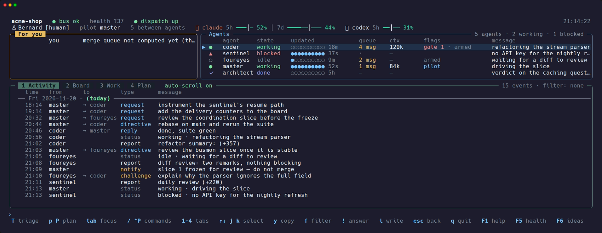

<p align="center"></p>

# agent-bus

**English** · [Français](README.fr.md)

agent-bus runs a team of AI coding agents on your own machine and keeps them coordinated:

- **The bus.** A Redis Streams bus: one Redis container, under a project namespace.
- **The tools.** Two Go binaries: `agentbus`, the command line, and `busmon`, the terminal dashboard.
- **No outside dependency.** It relies on no other project.

It aims to stay **small and light on your LLM subscriptions**:

- **Nothing polls an agent.** An idle agent waits without spending tokens.
- **A one-line wake.** One dispatcher types a single fixed line into an agent's terminal when work is waiting for it.
- **Local readings.** Usage windows and context fill are read from local files.

<p align="center"></p>

<p align="center"><sub>busmon on a fictional project (<code>acme-shop</code>), seeded by <code>scripts/busmon-demo.sh</code>.</sub></p>

**What you get**

- **A team in one command.** Run `agentbus start` in a project folder. It starts the roles (master,
  coder, foureyes, sentinel, and others on demand) for Claude Code, Codex and other clients, from one
  manifest, `roles.toml`.
- **Agent terminals you can step into.** Each project's agents run in terminals hosted by a
  background service, the *holder*:
  - `agentbus attach <agent>` puts your terminal on an agent's terminal;
  - `agentbus screen <agent>` prints its last screen;
  - closing busmon or your terminal does not stop the agents.
- **A live dashboard.** `busmon` shows:
  - who is working, blocked or waiting for you;
  - the task board and the tracked requests;
  - the questions put to you, and the PRs waiting for your merge.
- **Wake-ups without polling.** The dispatcher service wakes an idle agent when a message is waiting for
  it, and escalates to master when nobody answers.
- **Reviewed delivery.** Every change is approved by two reviewers on its exact commit before it is
  pushed. PRs go to the project's delivery branch (`dev` here), and `main` takes only promotions.
- **A CI loop.** On GitHub, a PR whose checks fail goes back to its author a few times, then to you.
- **Quotas, context and health watched for you.**
  - Usage windows are read locally, and the project pauses before a limit.
  - An agent hands off near a full context.
  - Measured health has its own page in busmon (F5).

## Where it runs

agent-bus is **v0.x** and built for **one operator**: one person, on their own machine. Commands
and screens still change between releases. There are no accounts and no access control, and the broker
is a Redis bound to `127.0.0.1`.

| | Linux | macOS | Windows |
|---|---|---|---|
| Status | developed and used daily | builds, not used daily | not supported (does not compile) |
| Services (dispatcher, missions, holder) | systemd `--user` | launchd, in your GUI session | — |
| Redis broker | Docker with Compose (`redis:8-alpine`) | Docker with Compose | — |

With no service manager, set `services.manager = none` in `config.toml`. The services then run as
detached supervisors.

The launcher knows five clients:

| Client | Resume a session | Automatic working/idle state |
|---|---|---|
| Claude Code (`claude`) | yes | yes, from its hooks |
| Codex CLI (`codex`) | not yet | yes, from its hooks |
| Grok Build (`grok`, beta) | not yet | yes, from its hooks |
| Kimi Code CLI (`kimi`) | no | no |
| Antigravity CLI (`agy`) | no | no: the agent declares it |

Context fill and token counts come from Claude Code only.

## Install

You need Linux or macOS, Go (the version in `go.mod`), Docker with Compose, Git, curl and at least
one agent client.

```bash
git clone https://github.com/netbja/agent-bus-monitor && cd agent-bus-monitor
./setup.sh install                     # binaries, skills, the Redis broker
agentbus statusline --print-install    # Claude Code users: the statusLine block for ~/.claude/settings.json
```

`./setup.sh install` does four things:

- **The binaries.** It builds `agentbus` and `busmon` into the repository and into `~/.local/bin`
  (`--bin-dir` changes it).
- **The skills.** It links the role skills.
- **The broker.** It starts the broker (`docker compose up -d`, port 6380).
- **The password.** On a fresh broker, it writes a random Redis password to
  `~/.config/agentbus/redis.env`. `agentbus` and `busmon` read it from there.

The install takes these options:

- `--dry-run` shows the actions and changes nothing;
- `--no-docker` leaves the broker alone;
- `--no-skills` skips the skills.

The `statusLine` step is what gives agent-bus Claude Code's rate limits and context fill. Other clients
need nothing.

Other `setup.sh` commands:

| Command | What it does |
|---|---|
| `./setup.sh update` | `git pull --ff-only`, then install. Afterwards it lists this machine's services still on the old build and restarts them on your yes |
| `./setup.sh status` | what is installed |
| `./setup.sh uninstall [--yes] [--purge]` | removes it, asking at each step; `--purge` also removes the broker and its data |
| `./setup.sh rotate-redis-password [--dry-run] [--yes]` | replaces the broker's password |

`agentbus update` installs the latest release tag with a snapshot to roll back to
(`agentbus update --check` prints the plan; [spec](docs/superpowers/specs/2026-11-20-agentbus-update-design.md)).
It refuses a `dev` build, so `./setup.sh update` remains the path from a clone. After an update,
the agents keep running on the previous build until you move them (see
[Update](docs/OPERATIONAL-GUIDE.md#7-update-the-tools)).

## Start a team

```bash
cd ~/code/myproject
agentbus start            # deduce the project, show it, start it, open busmon
```

`agentbus start`:

1. deduces the project's name, your name and the team, and asks only for what it cannot deduce
   (`--yes` takes the deduced values, `--dry-run` shows the plan);
2. runs `agentbus up <project> <path>`, which starts the project's services and its agents on the
   project's holder;
3. opens busmon in your terminal.

A project name is lowercase: a letter, then letters, digits, `-` or `_`, 32 characters at most.

**Later:**

- **Reopen the dashboard:** `busmon -p myproject`. `busmon --pick` chooses among your project templates.
- **Restart the team:** `agentbus up myproject`. Add `--resume` to resume the agents' sessions.
- **Stop it:** `agentbus down myproject` stops the services and the holder, with the agents in it.
  Nothing is deleted.

**Reaching an agent.** In busmon, select an agent and press `t`. From a shell:

```bash
agentbus -p myproject attach coder           # your terminal on coder's; F12 then d comes back
agentbus -p myproject attach coder --observe # watch only
agentbus -p myproject screen coder           # print its last screen, read-only
```

The attach prefix is `attach.prefix`, `f12` by default. A client that does not let F12 through, such as
Kimi or agy, needs `--prefix <key>` (`f1`-`f12`, `ctrl+<letter>`, `ctrl+\` or `ctrl+]`).

**Who you are.** busmon writes as you: `--as <name>`, `AGENT_BUS_HUMAN`, or `agentbus identity set
<name>`. A command that writes is refused rather than sent anonymously. Inside an agent's
terminal, a command writes as that agent (`AGENT_BUS_AGENT`).

The [operations guide](docs/OPERATIONAL-GUIDE.md) walks through a day with the team: starting work,
watching it, answering questions, merging, updating and stopping.

## How the team works

- **Roles.** `roles.toml` defines them, and adding one needs no code change:
  - **The boot roles:** `master` (coordinates), `coder` (implements, test first), `foureyes`
    (reviews) and `sentinel` (daily health review).
  - **The pop roles:** master pops `coder2`, `architect`, `docs`, `security`, `deploy` or `infra` with
    `agentbus pop <role>`.
  - **Profiles:** each role runs on a profile (client, model, permissions). See
    [agent profiles](docs/AGENT-PROFILES.md).
- **The holder.** A user service per project and build (`agentbus holder`). It hosts every agent's
  terminal, keeps it running when no one watches, and is what `attach` and `screen` read.
- **The dispatcher.** A service (`agentbus dispatch`), and the only automated writer to an agent's
  terminal. It types:
  - the fixed wake line;
  - `/clear` after an agent's declared hand-off (`dispatch.auto_clear`).

  It also:
  - waits while you are typing in that terminal;
  - escalates an agent that does not answer;
  - relaunches a dead agent in a new terminal (self-repair);
  - watches quotas, context and health.

  It never runs repository code.
- **4-eyes review and delivery.**
  - **Review.** An author challenges two reviewers (`agentbus challenge`). Each records a verdict on
    the exact commit (`agentbus verdict --head`).
  - **Delivery.** Only master or the docs agent delivers: `agentbus deliver <branch>` pushes the
    approved head and opens the PR.
  - **The base.** The PR goes to the project template's `[delivery] base`, else `delivery.base` (`main`
    by default). This repository delivers to `dev`.
  - **main.** It moves only by master's fast-forward of a released `dev`, on your yes.
  - **Your merges.** `agentbus merge-queue` lists what waits for your merge, and busmon shows it.
- **The CI loop.** GitHub with `gh` only.
  - When a PR's checks fail, the author is woken with the failing checks and their links.
  - After `ci.max_handoffs` hand-offs (3 by default), the loop stops and you get a notice.
    `agentbus ci reset <pr>` gives the author more tries.
  - `ci.loop = false` turns it off.
- **Missions** for large changes. The conductor service (`agentbus missions`) merges, tests and reviews
  agents' work on local branches, task by task (`agentbus mission load`).
- **Questions to you.** An agent asks with `agentbus ask`. busmon shows the options, and your answer
  wakes the agent.
- **A run budget** (off by default). With `run.max_duration` or `run.max_deliveries` set, the team
  drains at the limit and the project pauses. `agentbus run reset` starts a new run.

## Everyday commands

| Command | What it does |
|---|---|
| `agentbus start` / `up <p>` / `down <p>` | start a team (from its folder) / start it / stop its services and agents |
| `agentbus -p <p> attach <agent>` / `screen <agent>` | step into an agent's terminal / read it |
| `agentbus -p <p> agents` | every agent's declared state |
| `agentbus -p <p> pop <role>` / `retire <role>` | add a pop role / remove one |
| `agentbus -p <p> service status` / `service logs dispatch -n 100` | the project's services / their logs |
| `agentbus -p <p> merge-queue` | what waits for your merge |
| `agentbus -p <p> ask` / `asks` / `answer` | questions to the person |
| `agentbus -p <p> pause --for 2h` / `resume` | nobody is woken until then |
| `agentbus suspend` / `agentbus resume --all` | put every project of this machine to sleep before a reboot / bring them back |
| `agentbus quota` / `tokens` / `health` | usage windows / tokens spent / measured health |
| `agentbus backup` / `restore` | an archive of every project's keys, settings and history / restore one |
| `agentbus config` | each setting's value and where it comes from |
| `agentbus help <command>` | one command's usage, flags and examples |

`--project <p>` (or `-p`, or `AGENT_BUS_PROJECT`) is required wherever a command acts on one project.

## busmon

`busmon -p <project>` is your window on the team:

- the header with the services' state;
- *For you*: what waits for you;
- the agents;
- the tabs (number keys): `1` Activity, `2` Board, `3` Work, `4` Plan, the loaded plan's roadmap
  (`p` opens it as a drawer); under 80 columns one view at a time, `1` For you to `6` Plan.

Useful keys:

- `F1` lists every key;
- `t` attaches to the selected agent;
- `F3` shows the services and the holders;
- `F5` shows health;
- `M` shows every project of this machine;
- `C` opens the settings;
- `q` quits.

Display settings, edited from `C` or in `config.toml`:

| Setting | Values (default first) |
|---|---|
| `display.theme` | `auto`, `dark`, `light` |
| `display.graphs` | `auto`, `block`, `braille`, `ascii` |
| `display.icons` | `off`, `nerd`, `agent-font` |
| `display.date_format` | `relative`, `iso`, `clock12` |
| `display.work_layout` | `auto`, `list`, `kanban` |

`agentbus config` lists every setting, its value and its source.

## Settings

Your preferences live in one file, `~/.config/agentbus/config.toml`, under `$XDG_CONFIG_HOME` when it
is set:

- **Precedence.** The environment wins over the file, and the file over the defaults.
- **Seeing them.** `agentbus config` shows each value and where it comes from; `--project <p>` adds
  what that project's services see.
- **Secrets stay out of this file.** Notification targets are in `notify.toml` beside it, and the Redis
  password is in `redis.env`.

Settings an operator usually touches:

- **Delivery:** `delivery.base`, `delivery.forge`.
- **CI loop:** `ci.loop`, `ci.max_handoffs`.
- **Run budget:** `run.max_duration`, `run.max_deliveries`.
- **Services and terminals:** `services.manager`, `services.start_at_login`, `attach.prefix`.
- **Context:** `dispatch.context_alert` (80 %), `dispatch.auto_clear`.
- **Notifications:** `notify.on`.
- **Backups:** `backup.schedule`.

## The broker and connections

- **The broker.** `docker compose up -d` starts `redis:8-alpine`, bound to `127.0.0.1:6380` only, never
  the LAN. The password travels in clear, so the broker is never exposed raw.
- **Connection order.** Both `agentbus` and `busmon` connect with `REDIS_URL` when it is set. Otherwise
  they use `REDIS_HOST` / `REDIS_PORT` (`localhost` / `6380`), with the password from `REDIS_PASSWORD`,
  else `~/.config/agentbus/redis.env`. `--host` overrides `REDIS_HOST`.
- **Watching another machine's bus.** Use an SSH tunnel:

```bash
ssh -NL 6381:localhost:6380 user@your-host &   # that host's bus on local :6381
REDIS_PORT=6381 busmon -p <project>              # with that host's redis.env or REDIS_PASSWORD
./remote-bus.sh user@your-host                   # the same, the tunnel closed on exit
```

Agents' terminals are local to the machine whose holder runs them: you attach there, not through the
tunnel.

## Not built yet

These are written as specs and not built:

- The quiet update, `agentbus update`'s automatic mode
  ([spec](docs/superpowers/specs/2026-11-14-quiet-update-design.md)): `agentbus update` is manual.
- `agentbus feedback`, statistics over past reviews
  ([spec](docs/superpowers/specs/2026-10-29-feedback-loop-design.md)).
- PR readers for GitLab and Bitbucket. Until then the merge queue and the CI loop read GitHub only,
  while `agentbus deliver` already opens GitLab merge requests and prints Bitbucket's page.

## More

- [Operations guide](docs/OPERATIONAL-GUIDE.md): day-to-day running of a team.
- [Architecture](docs/architecture.md): the packages, the streams and keys, who writes what.
- [Operator notes](docs/operator-notes.md), with newer ones in
  [docs/operator-notes.d/](docs/operator-notes.d/): the details that bite.
- [CHANGELOG](CHANGELOG.md) and [release notes](docs/releases/).
- Developing agent-bus itself: see [CLAUDE.md](CLAUDE.md) and [AGENTS.md](AGENTS.md). Tests use a
  disposable Redis only ([Redis test setup](docs/testing-redis.md)).

## Licence

MIT, see [LICENSE](LICENSE). Copyright (c) 2026 NetBJA.
